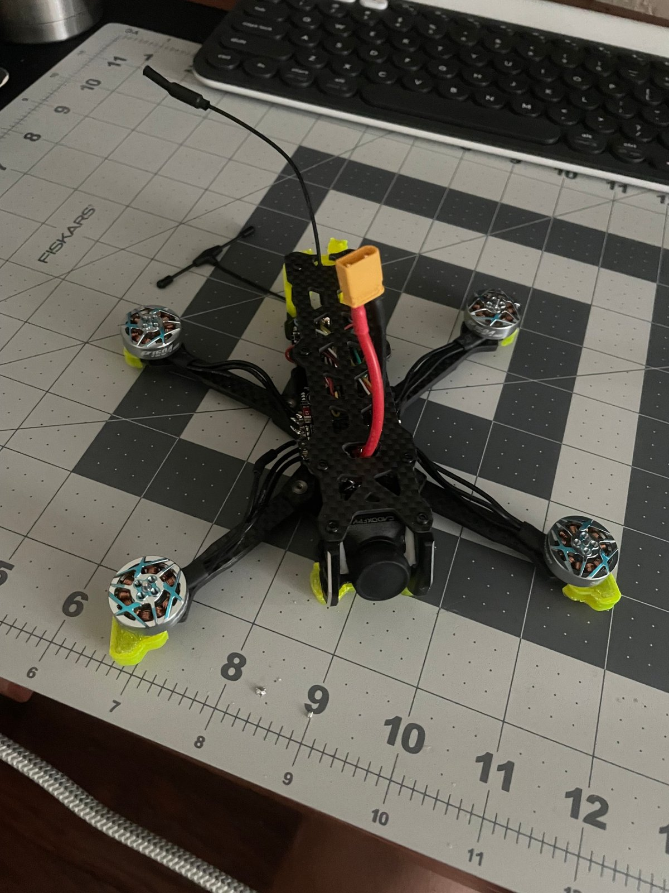

# 3.5" Analog FPV Freestyle Quad: Build Log and Beginner's Guide

A complete build log of a 3.5-inch analog FPV freestyle quad, written so a beginner can follow the *reasoning*, not only the steps. I used a YouTube build as my starting point (credited below) and documented everything along the way: part choices, wiring, ESC firmware, Betaflight setup, battery handling, and a video transmitter failure that I diagnosed with a multimeter and the flight controller's current sensor.

**Status:** complete. Motors, radio link, video link, and battery monitoring are all verified.
**Demo:** [final test video](media/video/final-test.mp4)

> **The one rule this build taught me the hard way:** never power a video transmitter (VTX) without its antenna attached. My first VTX lost its output amplifier and had to be replaced. The full diagnosis is in [troubleshooting/vtx-amplifier-failure.md](troubleshooting/vtx-amplifier-failure.md).

---

## Specs at a glance

| Component | Part | Notes |
|---|---|---|
| Frame | FlyFishRC Volador VX3.5 | 160 mm wheelbase, squashed-X, T700 carbon |
| Flight controller + ESC | SpeedyBee F405 Mini + BLS 35A Mini V2 (20x20 stack) | 4-in-1 ESC, 35 A per motor |
| ESC firmware | Bluejay (latest stable) | Flashed over the stock BLHeli_S firmware |
| Motors | T-Hobby (T-Motor) Pacer P1604 3800KV | 1.5 mm shaft, T-mount props |
| Props | HQProp T3.5x2.5x3 | 3-blade, 1.5 mm T-mount |
| Battery | Tattu R-Line V5 850 mAh 4S 150C | XT30 connector |
| Camera | Caddx Ratel 2 V2 | Analog, 1200TVL, 2.1 mm lens |
| Video transmitter | AKK FX3-ultimate | Replaced a failed 1 W Cyclone VTX |
| Receiver | SpeedyBee Nano 2.4 GHz ELRS | CRSF protocol |
| Radio / goggles | RadioMaster T8L (ELRS) / VR009 analog goggles | |
| Video channel | Band B, channel 3 (5771 MHz), 25 mW | |
| **All-up weight** | **238.36 g** | With battery; under the 250 g mark |

Full parts list with prices and the reasoning behind each choice: [bom/README.md](bom/README.md)

---

## Repo map

| Folder / file | What's inside |
|---|---|
| [bom/](bom/) | Bill of materials (parts, prices, weights) and why each part was chosen |
| [build-log/](build-log/) | Seven build stages, in order, with photos |
| [schematics/](schematics/) | Wiring diagram and pad-by-pad wiring table |
| [troubleshooting/](troubleshooting/) | Problems I hit and how I solved them, including the VTX failure case study |
| [analysis/](analysis/) | Measured data (charger cell balance, VTX current draw) |
| [configs/](configs/) | Betaflight settings |
| [media/](media/) | Photos and the final test video |
| [safety.md](safety.md) | LiPo, power-up, and radio safety rules |
| [lessons-learned.md](lessons-learned.md) | What I'd tell myself before starting |
| [future-improvements.md](future-improvements.md) | Where this build can go next (digital video, tuning, data) |

## Suggested reading order

1. [Safety](safety.md): read this before touching a LiPo
2. [Parts and why](bom/README.md)
3. Build log: [01](build-log/01-planning-and-parts.md) → [02](build-log/02-frame-and-motors.md) → [03](build-log/03-soldering-and-wiring.md) → [04](build-log/04-esc-firmware-bluejay.md) → [05](build-log/05-betaflight-setup.md) → [06](build-log/06-battery-and-charging.md) → [07](build-log/07-final-assembly-and-test.md)
4. [Troubleshooting](troubleshooting/README.md)
5. [Lessons learned](lessons-learned.md) and [future improvements](future-improvements.md)

---

## What this repo adds beyond the video

- **A diagnosed hardware failure.** Measured current draw at different VTX power settings to show the amplifier wasn't producing output, then compared it against reference datasheet values.
- **ESC firmware upgrade to Bluejay**, which unlocks motor RPM data for better gyro filtering.
- **Crash protection on a budget:** motor wires wrapped in black athletic tape.
- **A wiring table and diagram** of the as-built quad.
- **Plain-language explanations** of the terms beginners run into (UART, SmartAudio, C-rate, VTX table, and more).

## Key takeaways

1. **Antenna on before power, every time.** A VTX without an antenna has nowhere to send its energy, and the amplifier can be damaged in seconds.
2. **Use a smoke stopper for the first power-up.** It limits current, so a wiring mistake costs a fuse instead of a flight controller.
3. **Measure instead of guessing.** A multimeter and Betaflight's current readout were enough to find a dead amplifier.

---

## Credits

- Build inspired by **[How to build a sub 250g 3.5-inch freestyle FPV Drone for $160](https://www.youtube.com/watch?v=aXrrg48auhU)** by **Hoarder Sam**
- The wiring, measurements, troubleshooting, and write-up in this repo are my own documentation of my build. Any mistakes are mine.

## License

- Written documentation and photos: [CC BY 4.0](https://creativecommons.org/licenses/by/4.0/). Share and adapt with credit.
- Config files: MIT ([LICENSE](LICENSE)).

*Built and documented by Kardal Haist, Electrical Engineering, Florida Tech.*
