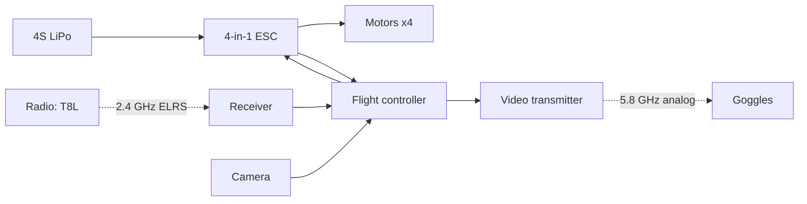
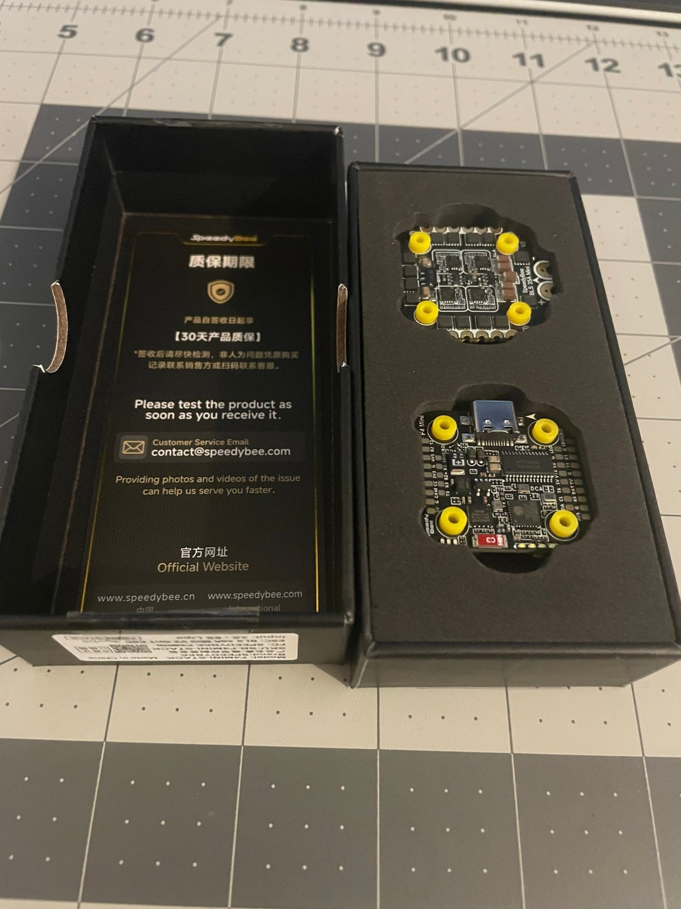
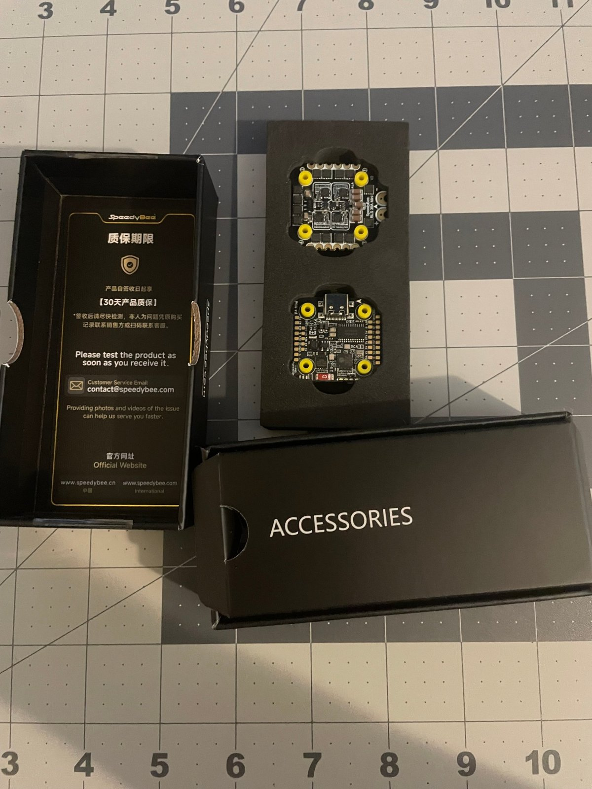
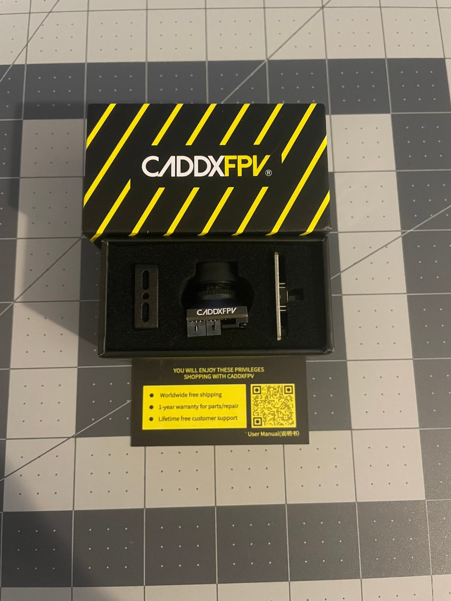
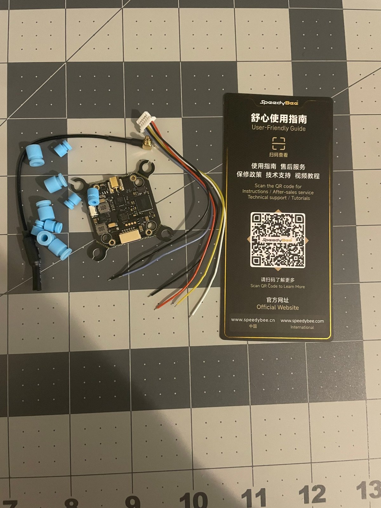
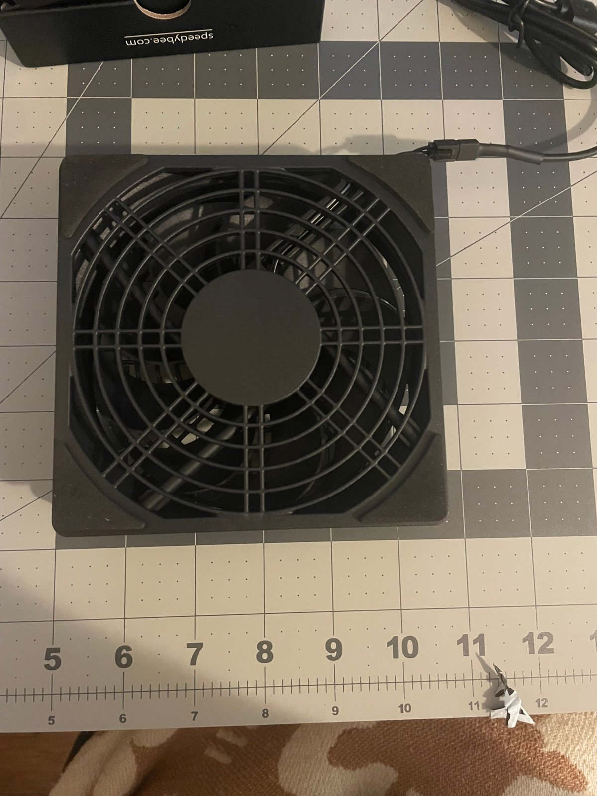

# 01 · Planning and Parts

[← Back to README](../README.md) · [Next: Frame and motors →](02-frame-and-motors.md)

## Goal

Build a 3.5-inch analog freestyle quad that is:
- small enough for parks and backyards,
- durable enough to crash while learning,
- cheap enough that broken parts don't end the project.

The full parts list and the reasoning behind each choice are in the [BOM](../bom/README.md).

## How the system fits together

An FPV quad is really two separate systems that share one battery:

1. **Flight system:** radio → receiver → flight controller → ESC → motors. This is what makes it fly.
2. **Video system:** camera → flight controller (adds the on-screen display) → video transmitter → goggles. This is what lets you see.

Keeping the two systems separate in your head makes troubleshooting easier. When my video failed, the quad still armed and spun motors normally, which told me straight away the fault was on the video side.

## Unboxing the electronics

The **stack** is two boards that bolt on top of each other:
- the **flight controller (FC)**, the board with the USB-C port, which runs Betaflight;
- the **4-in-1 ESC** (electronic speed controller), which turns battery power into the three-phase drive each brushless motor needs.

The accessories box includes the FC-to-ESC harness, the rubber grommets, and a **35 V 470 µF low-ESR capacitor**. Solder that capacitor across the battery pads. It absorbs voltage spikes created by the motors, which would otherwise show up as noise in your video and on the gyro.

This is the **original** video transmitter, which I later had to replace. See the [failure case study](../troubleshooting/vtx-amplifier-failure.md).

## Bench equipment

A cheap 5 V USB fan does a lot. Small quads rely on airflow from the props to cool the VTX and ESC, and on the bench there isn't any. I kept the fan blowing on the stack during every powered test.

Other bench gear worth having before you start:
- a soldering iron with a fine tip, plus flux;
- a multimeter (you need it for continuity and voltage checks);
- a **smoke stopper** (see [stage 03](03-soldering-and-wiring.md));
- a LiPo-safe charging spot.

## Before you buy, check

- **Radio band matches the receiver.** My T8L is 2.4 GHz ELRS only, so the receiver had to be 2.4 GHz ELRS.
- **Goggles match the video system.** The VR009 goggles are analog 5.8 GHz, so the VTX had to be analog.
- **VTX input voltage.** Some VTXs are 5 V only and die on battery voltage.
- **Mounting patterns.** The VX3.5 takes 20x20 or 25.5x25.5 mm (M2) stacks and VTXs. A 30.5 mm board will not bolt on.
