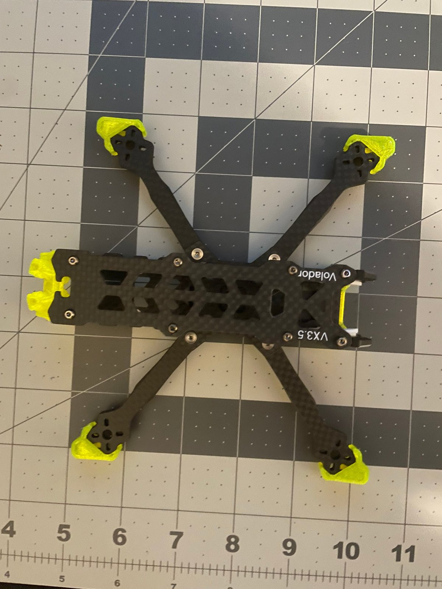
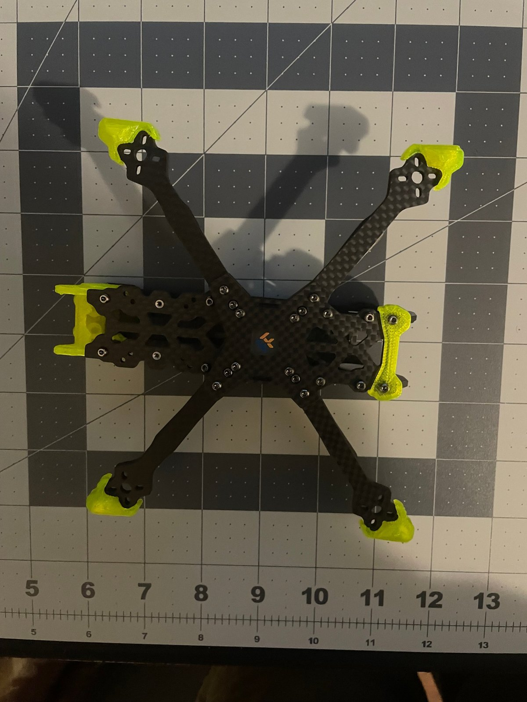
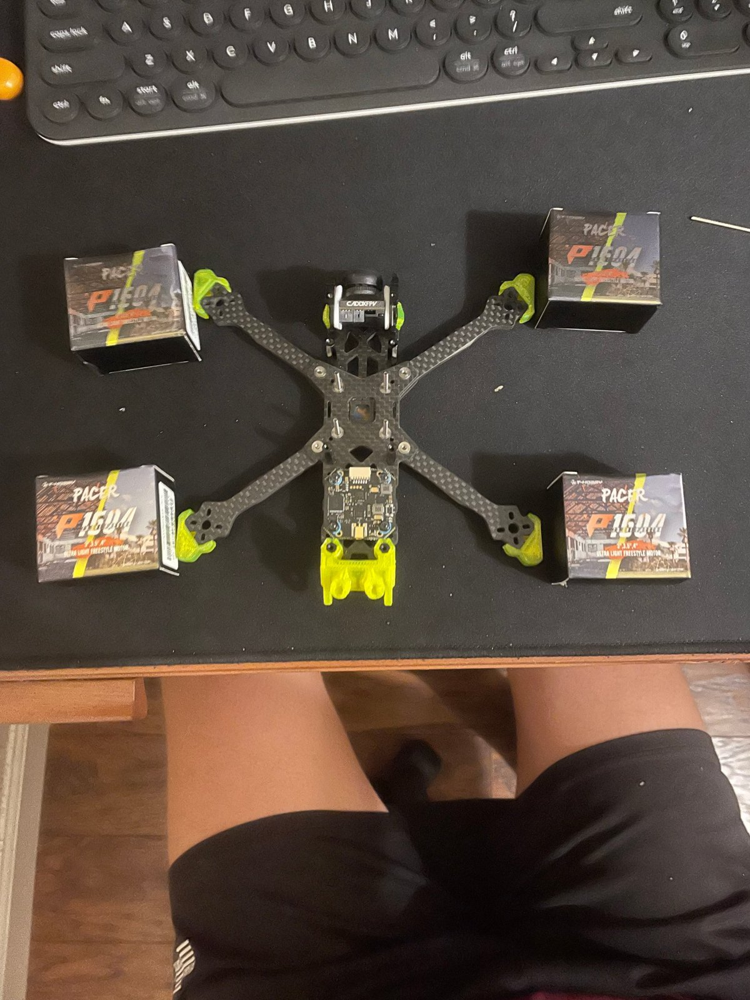
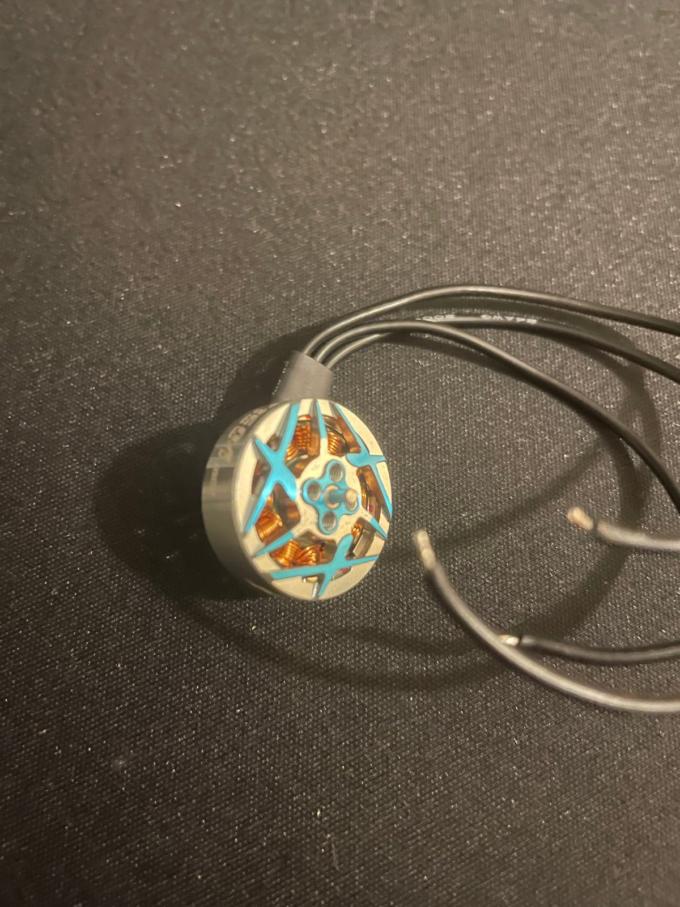

# 02 · Frame and Motors

[← Previous: Planning](01-planning-and-parts.md) · [Back to README](../README.md) · [Next: Soldering and wiring →](03-soldering-and-wiring.md)

## Frame assembly

The FlyFishRC Volador VX3.5 is a **squashed-X** frame: the front and rear motors are closer together side to side than front to back. That shape gives more room in the middle for electronics and tends to feel more stable in pitch.

The neon parts are **TPU**, a flexible 3D-printed plastic. They protect the arm ends and hold the antennas and battery strap. TPU bends on impact instead of cracking.

**Tips:**
- The frame hardware ships with threadlocker already applied. Don't add more, and don't over-tighten screws into aluminum.
- Leave the top plate off until all the soldering is finished.

## Motors

The T-Hobby Pacer P1604 is a **brushless outrunner**. The outer bell (with the magnets) spins around a fixed set of copper windings called the **stator**. "1604" means the stator is 16 mm wide and 4 mm tall. "3800KV" means about 3800 RPM per volt with no prop attached.

**Mounting:**
- The motors bolt to the arms with M2 screws in a 9x9 mm pattern.
- **Screw length matters.** A screw that is too long pokes through into the stator windings, scrapes the insulation, and can short a winding. After installing each motor, spin the bell by hand. It should turn smoothly, with only the faint even notchiness of the magnets.
- One of my motors felt gritty when I spun it by hand (see [troubleshooting](../troubleshooting/README.md#gritty-motor)). Check every motor before you solder anything to it.

## Crash protection: athletic tape on the motor wires

Motor wires run along the arms, and the arms are the first thing to hit the ground. I wrapped each arm's wire bundle in **black athletic tape**. It's cheap, light, and slightly padded, and it holds the wires tight against the carbon so a prop or a rock can't snag them. After several crashes, no wire insulation has been cut.

Heat-shrink tubing or spiral wrap work too, but athletic tape is fast to apply and easy to remove for repairs.

## Props

The props are HQProp T3.5x2.5x3 **T-mount** props. Instead of a nut, each prop is held by two M2 screws into the motor bell, with the 1.5 mm shaft centering it.

**Prop direction matters.** Each motor spins either clockwise (CW) or counterclockwise (CCW), and the props are molded to match. Leave props off until [stage 07](07-final-assembly-and-test.md).
