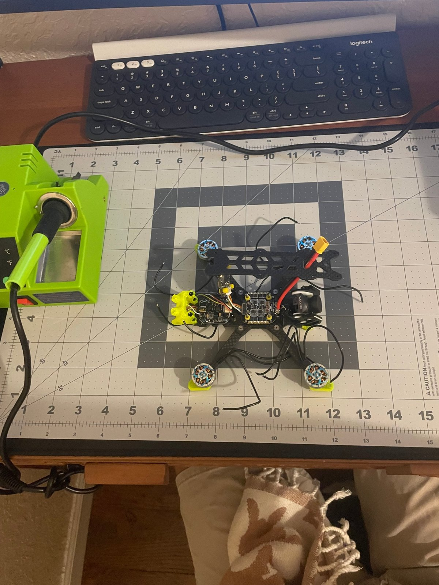
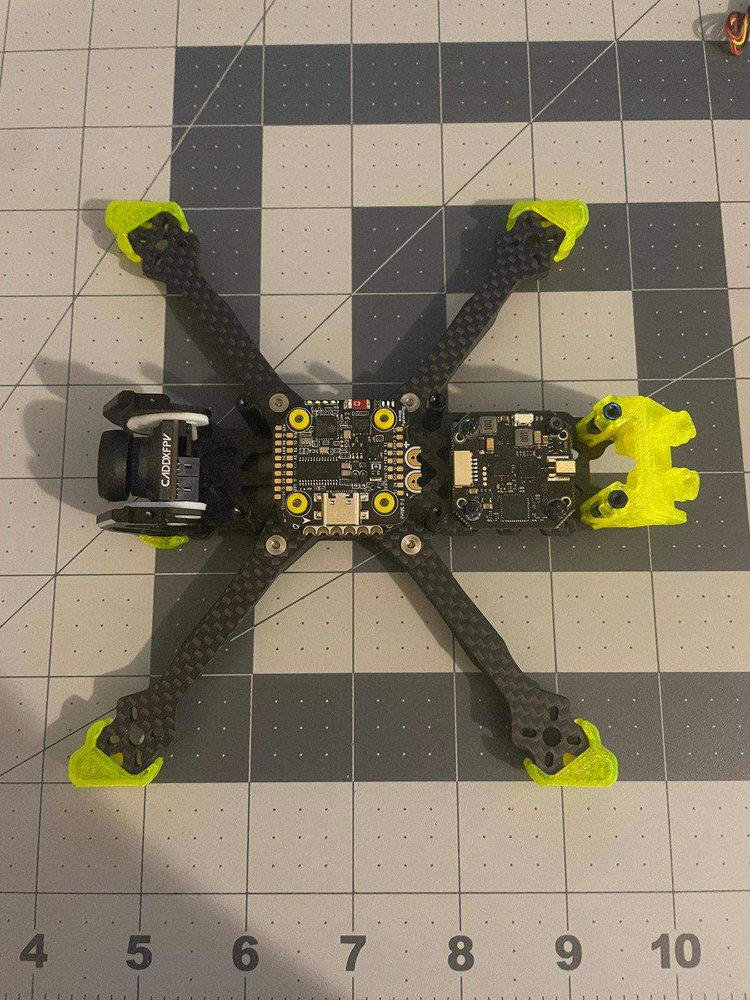
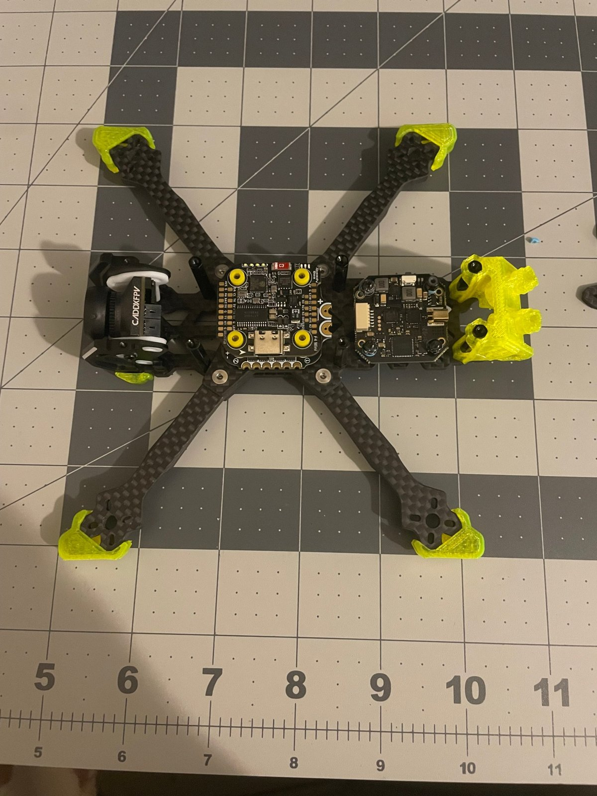
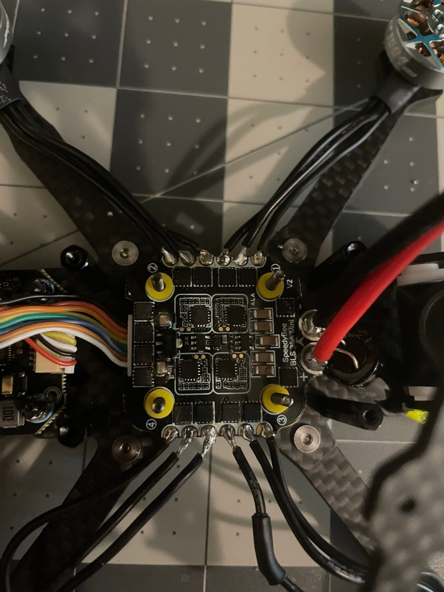
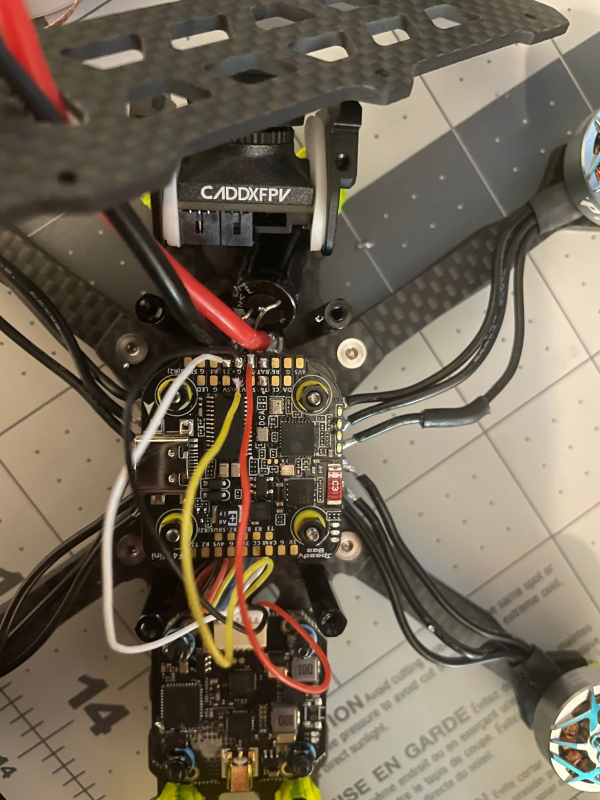
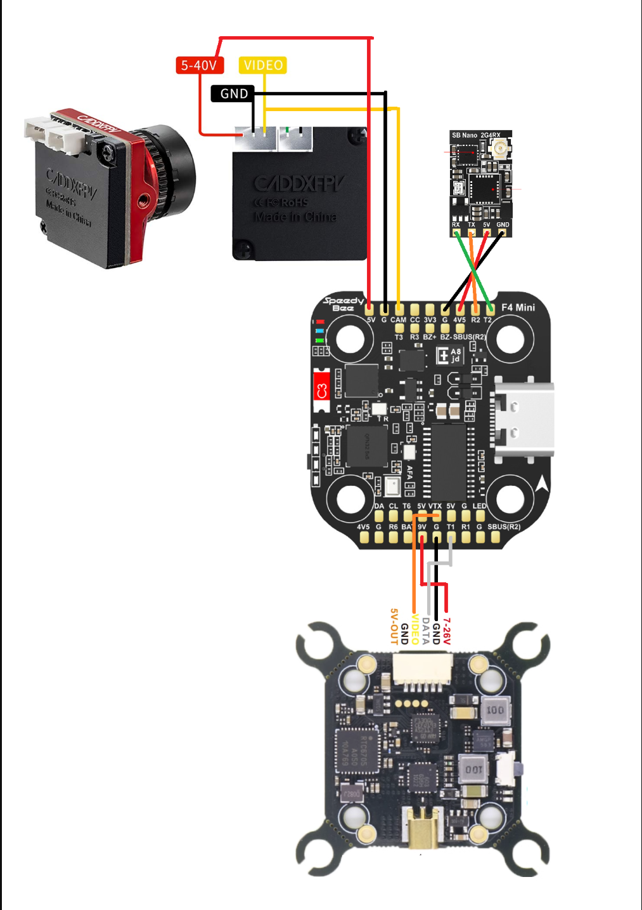

# 03 · Soldering and Wiring

[← Previous: Frame and motors](02-frame-and-motors.md) · [Back to README](../README.md) · [Next: ESC firmware →](04-esc-firmware-bluejay.md)

The full pad-by-pad wiring table and diagram are in [schematics/](../schematics/README.md). This page covers the order of work and the techniques.

## Setup

**Order of work:**
1. Motor wires to the ESC
2. Battery lead and capacitor to the ESC
3. FC-to-ESC harness
4. Camera, receiver, and VTX to the FC

Work from the biggest, hottest joints to the smallest. That way you aren't holding a hot iron near finished small joints.

## Stack mounted in the frame

The stack sits on rubber **grommets** (soft spacers). They isolate the gyro from frame vibration. Vibration that reaches the gyro looks like motion to the flight controller, which makes the motors work harder and run hot.

**Check the FC arrow.** The flight controller has an arrow printed on it that must point to the front of the quad. If it doesn't, you must tell Betaflight the board is rotated, or the quad will flip on takeoff.

## Motor and power joints on the ESC

- **Tin both surfaces first.** Put a small amount of solder on the pad and on the wire, then join them. The joint should be shiny and fully wet the pad, not balled up on top.
- **Motor wire order doesn't matter yet.** Swapping any two of a motor's three wires reverses its direction. You can also fix direction in software, which I did in [stage 04](04-esc-firmware-bluejay.md).
- **The battery lead needs the most heat.** Thick wire on a large pad sinks heat fast, so use a bigger tip and more temperature than for the signal pads.
- Solder the **capacitor** across the battery pads with the correct polarity. The stripe on the capacitor marks negative.

## Flight controller wiring

The diagram above is the plan I soldered from (it shows the original VTX; the replacement uses the same FC pads). Details are in [schematics/](../schematics/README.md).

| Device | Connects to (FC pads) | Why |
|---|---|---|
| Camera | 5V, G, CAM | Power plus the analog video signal into the FC, which adds the OSD |
| Receiver | 4V5, G, R2, T2 | **UART2.** The receiver's TX goes to the FC's RX and vice versa |
| VTX | 9V, G, VTX, T1 | Power, video out, and SmartAudio control on **UART1** |

**UART** (universal asynchronous receiver-transmitter) is a two-wire serial link: one wire transmits (TX) and one receives (RX). One device's TX must go to the other's RX. Crossing them is the most common beginner wiring mistake.

**A side effect worth knowing:** the 4V5 pad is powered even over USB, so the receiver comes alive when the FC is plugged into a computer. That makes binding and checking the Receiver tab possible without a battery.

## First power-up: use a smoke stopper

Before the first battery connection:
1. **Continuity check.** With a multimeter in continuity (beep) mode, probe battery + to battery −. It should **not** beep. A beep means a short circuit.
2. **Smoke stopper.** This is a plug with a current-limiting fuse or bulb between the battery and the quad. If there's a short, the stopper limits the current instead of letting the battery dump hundreds of amps into your board.
3. **Antenna on the VTX.** Always, before power. [Here's why](../troubleshooting/vtx-amplifier-failure.md).
4. Connect the battery through the stopper. Check that nothing gets hot, the FC lights come on, and the ESC chimes.
