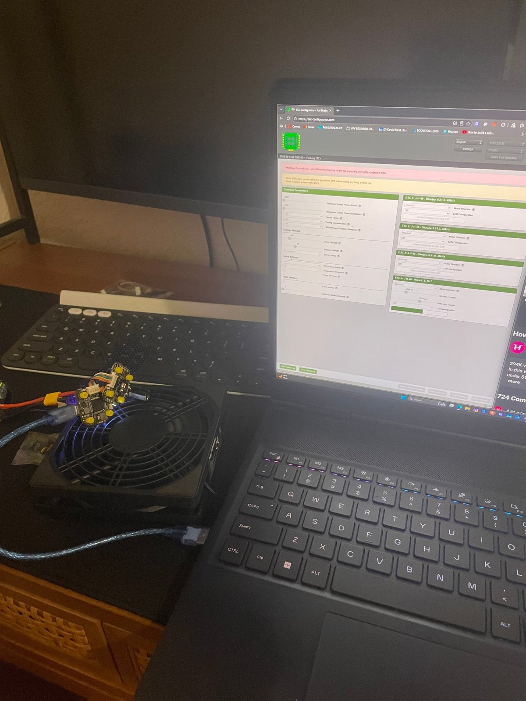
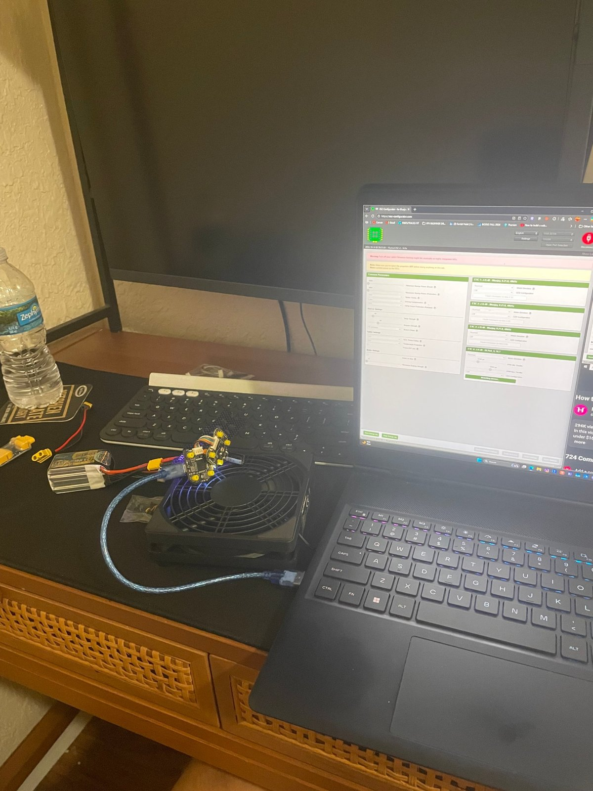
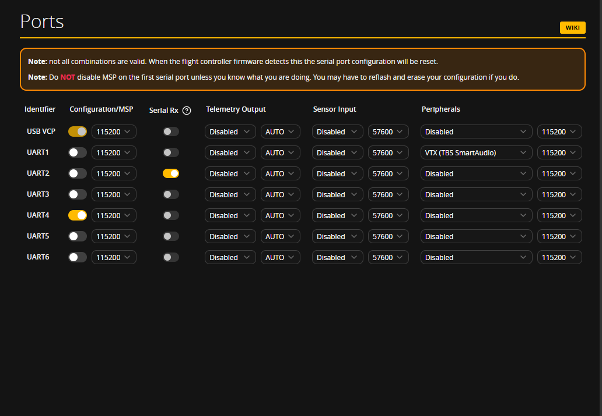
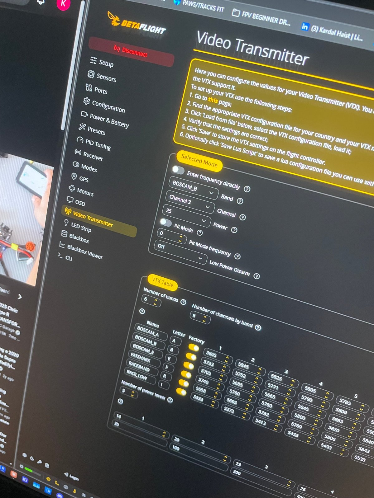

# 05 · Betaflight Setup

[← Previous: ESC firmware](04-esc-firmware-bluejay.md) · [Back to README](../README.md) · [Next: Battery and charging →](06-battery-and-charging.md)

**Betaflight** is the firmware running on the flight controller. **Betaflight Configurator** (app.betaflight.com) is the program on your computer that changes its settings. Keep the props off for this whole stage.

## Tab by tab

**Setup.** Move the quad by hand and check that the 3D model moves the same way. If it doesn't, the board orientation is wrong (Configuration tab).

**Ports.** Each UART is assigned one job:

| Port | Setting | Device |
|---|---|---|
| USB VCP | MSP on | Connection to Configurator. Never turn this off |
| UART1 | Peripherals: **VTX (TBS SmartAudio)** | Video transmitter control |
| UART2 | **Serial RX** on | ELRS receiver |
| UART4 | MSP on | SpeedyBee's built-in Bluetooth (for the phone app) |

**Configuration.** Set Receiver mode to **Serial (via UART)** with provider **CRSF** (the protocol ELRS uses). Also set the motor protocol and Bidirectional DShot (see [stage 04](04-esc-firmware-bluejay.md)).

**Receiver.** Move each stick and check that the matching bar moves the right way.
- Sticks centered should read about **1500**, throttle at minimum about **1000**.
- If roll and pitch are swapped, change the channel map.

**Modes.** Assign **ARM** to a switch on the radio. Move the switch and confirm the range lights up.

**Motors.** With the props off and the battery plugged in, enable the test switch and spin each motor briefly. Check that the order and direction match the diagram.

**Power & Battery.** Set the current meter scale and offset. SpeedyBee specifies **250** and **−500** for this ESC. I used these readings later to [diagnose the VTX](../troubleshooting/vtx-amplifier-failure.md).

**Failsafe.** Arm with the props off, then switch off the radio. The motors must stop. **Never fly without testing this.**

## Video transmitter tab

**SmartAudio** is a one-wire control protocol that lets Betaflight set the VTX's band, channel, and power. Betaflight needs a **VTX table** (the list of frequencies and power levels your VTX supports), which you load from a file for your VTX.

My settings:
- Band **B (BOSCAM_B)**, channel **3** (5771 MHz)
- Power **25 mW**
- Pit mode **off**

**Why 25 mW?** In the US, flying above 25 mW on 5.8 GHz generally requires an amateur radio license.

## Arming flags

When the quad won't arm, the Setup tab lists the reasons. The one that confused me: **MSP**. Betaflight blocks arming while Configurator is connected, so a quad on a USB cable can't spin up by surprise. Disconnect, unplug USB, and arm from the battery.

## Save your settings

Back up your settings with the CLI `diff all` command. See [configs/](../configs/README.md).
