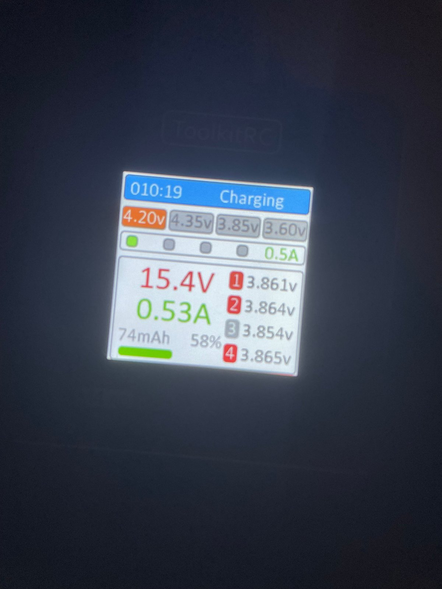
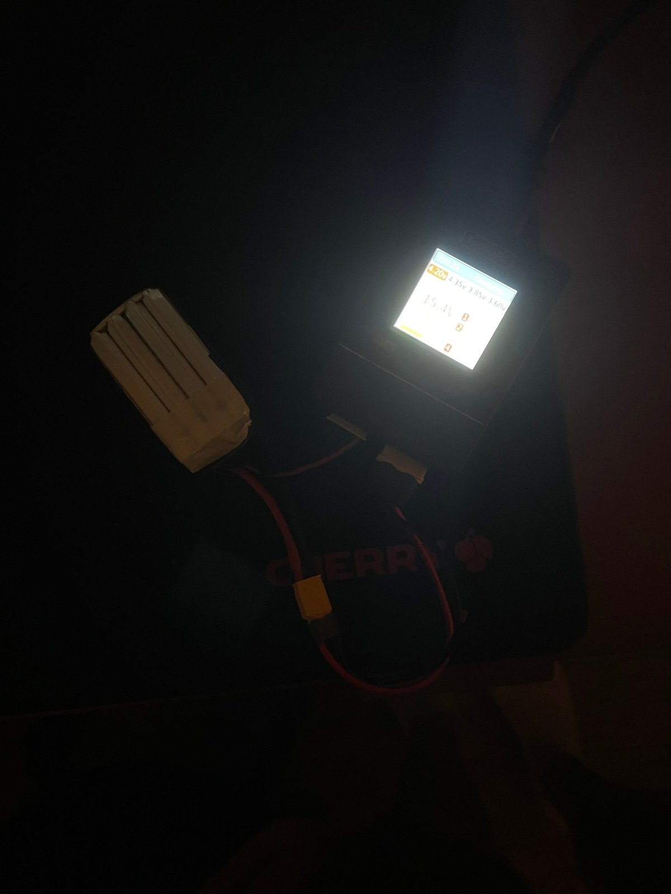

# 06 · Battery and Charging

[← Previous: Betaflight](05-betaflight-setup.md) · [Back to README](../README.md) · [Next: Final assembly →](07-final-assembly-and-test.md)

**Read [safety.md](../safety.md) first.** LiPo batteries are the most dangerous part of this hobby.

## Reading the battery label

**Tattu R-Line V5, 850 mAh, 4S, 150C**

| Label | Meaning |
|---|---|
| **4S** | 4 cells in series. Each LiPo cell is 3.7 V nominal and 4.2 V full, so the pack is 14.8 V nominal and **16.8 V full** |
| **850 mAh** | Capacity: the pack can deliver 850 mA for one hour (or more current for less time) |
| **150C** | Maximum discharge rate as a multiple of capacity. 150 × 0.85 A ≈ 127 A in theory. Treat C ratings as marketing; the real number is lower |

## Charger settings (ToolkitRC M4AC)

| Setting | Value | Why |
|---|---|---|
| Cell voltage | **4.20 V** | Standard LiPo full charge. 4.35 V is for LiHV packs only and would overcharge this one |
| Current | **0.5 A** | About 0.6C (charge current ÷ capacity: 0.5 A ÷ 0.85 Ah). Gentle and safe |
| Balance lead | Always connected | Lets the charger balance each cell |

**What the screen shows:** about 15.4 V at 0.53 A and 58% charge. Each cell reads 3.854 to 3.865 V, a spread of only **11 mV**. That small spread means the cells are well balanced. A healthy pack stays within a few tens of millivolts. A pack where one cell drifts far from the others is wearing out.

**Storage charge:** if you won't fly for several days, charge or discharge to about **3.8 V per cell** (15.2 V for the pack). LiPos degrade fastest when stored full.

## Low-voltage limits in Betaflight

| Setting | Value |
|---|---|
| Minimum cell voltage | 3.3 V |
| Warning cell voltage | 3.5 V |
| Maximum cell voltage | 4.3 V (Betaflight uses this only to detect the cell count) |

**Land when the OSD shows about 3.5 V per cell at rest.** Under load the voltage sags, so a reading right after punching the throttle will be lower than the pack's true charge.

**Cell-count glitch:** once, Betaflight detected **1 cell** instead of 4. It guesses the count when the battery connects. If the OSD shows the wrong count, unplug the battery and plug it back in.
