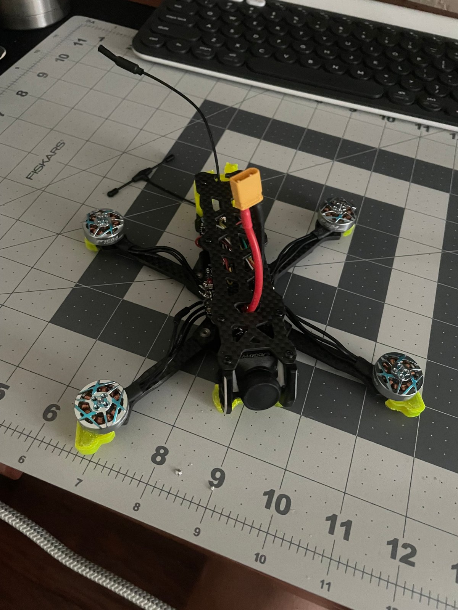

# 07 · Final Assembly and Test

[← Previous: Battery](06-battery-and-charging.md) · [Back to README](../README.md)

## Final assembly

1. **VTX antenna** mounted on the rear TPU part, pointing up and back, clear of the props.
2. **Receiver antenna:** the T-shaped dipole mounted away from the VTX antenna and carbon fiber. Carbon fiber is conductive and blocks radio signals.
3. **Motor wires** wrapped in athletic tape (see [stage 02](02-frame-and-motors.md)).
4. **Battery strap** and the anti-slip pad on the top plate.
5. **Top plate on.** Before closing it, check that no wire is pinched between the plates.

## Pre-flight checks (props off)

- [ ] Each motor spins in the correct direction, in the correct order
- [ ] Receiver tab: all sticks move the right way, ARM switch works
- [ ] Failsafe: radio off → motors stop
- [ ] Goggles show video and the OSD on the planned channel (B3, 5771 MHz)
- [ ] OSD shows the correct cell count and voltage
- [ ] Nothing hot after 1 minute on the bench

## Props on

- Match each prop to its motor's direction (props-in or props-out, as set in Betaflight).
- Tighten the two M2 prop screws snugly and evenly. Don't crush the hub.
- **Before the first flight:** make sure you are in a clear, open area with no people nearby.

## Result

[Final test video](../media/video/final-test.mp4)

The quad arms, hovers, and holds video on the goggles, and the radio link and OSD battery readout both work.

## What's next

See [future-improvements.md](../future-improvements.md).
