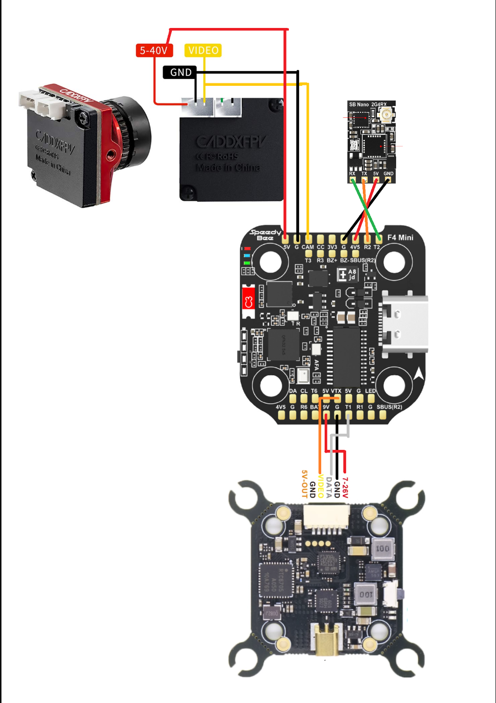
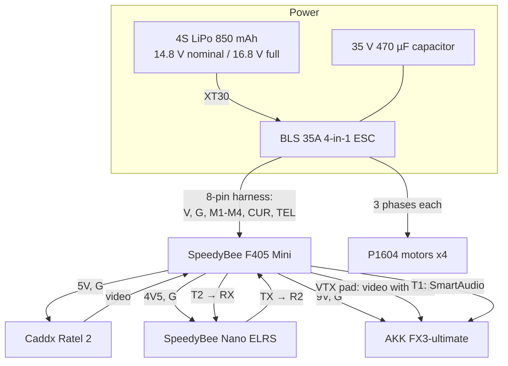

# Wiring and Schematics

[← Back to README](../README.md)

This page shows the quad **as built**.

## Wiring diagram (pads and wire colors)

This is the wiring plan I soldered from. The VTX pictured at the bottom is the **original** Cyclone VTX. Its replacement, the AKK FX3-ultimate, uses the **same four FC pads** (9V, G, VTX, T1); only the wire colors on the VTX side differ. See the table below.

**Reading the diagram:**
- **Camera (top left):** 5–40 V, GND, and VIDEO go to the FC's **5V**, **G**, and **CAM** pads.
- **Receiver (top right):** the TX and RX wires **cross** (receiver TX → FC **R2**, receiver RX → FC **T2**). 5V goes to **4V5** and GND to **G**.
- **VTX (bottom):** 7–26 V → **9V**, GND → **G**, VIDEO → **VTX**, DATA (SmartAudio) → **T1**. The VTX's own 5V-OUT and second GND are left unconnected.

## Block diagram

## Pad-by-pad wiring table

| From | Wire | To (FC pad) | Signal / voltage |
|---|---|---|---|
| Battery (XT30) | Red / black | ESC BAT+ / BAT− | 14.8–16.8 V |
| Capacitor | + / − | ESC BAT+ / BAT− | Spike filtering |
| ESC | 8-pin harness | FC 8-pin connector | Power plus motor signals, current sense, telemetry |
| Camera | Red | **5V** | 5 V supply (camera accepts 5–40 V) |
| Camera | Black | **G** | Ground |
| Camera | Yellow | **CAM** | Analog video in (CVBS) |
| Receiver | Red | **4V5** | About 4.5–5 V (also live on USB) |
| Receiver | Black | **G** | Ground |
| Receiver | TX | **R2** | UART2 receive |
| Receiver | RX | **T2** | UART2 transmit |
| VTX (AKK FX3) | Red (DC in) | **9V** | 9 V supply (VTX accepts 7–24 V) |
| VTX | Black | **G** | Ground |
| VTX | Yellow | **VTX** | Video out from the FC, with the OSD added |
| VTX | Green | **T1** | SmartAudio (UART1) |
| VTX | Red (5V out) and 2nd black | Not connected | Insulated with heat shrink |

## Design notes

- **Video path.** The camera's video goes *into* the FC first. The FC's OSD chip (AT7456E) overlays text such as battery voltage, then passes the signal out to the VTX.
- **Why the 9V pad for the VTX.** It is a regulated supply, so the VTX sees a steady voltage while the battery sags under throttle. Battery voltage would also have worked, since the AKK accepts up to 24 V.
- **Unused 5V output.** The AKK's 5 V camera output is left disconnected. Tying two 5 V regulators together (the VTX's and the FC's) makes them fight each other.
- **Shared ground.** Every device grounds to the FC. Video is a single-ended signal measured against ground, so a poor ground shows up as noise lines in the picture.
